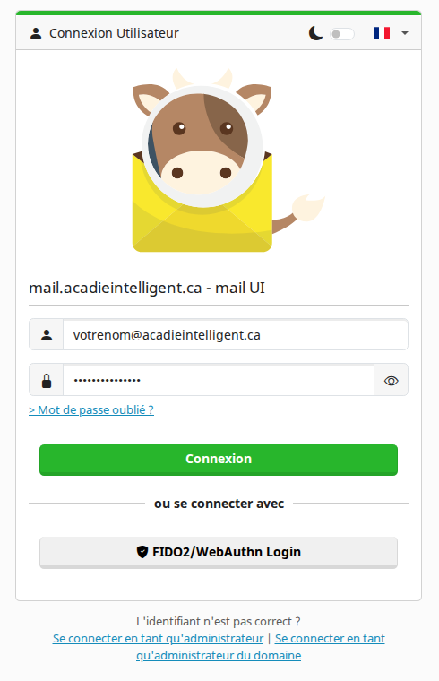
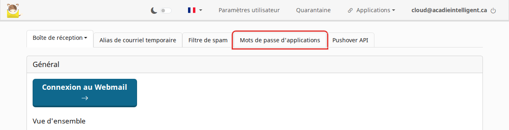
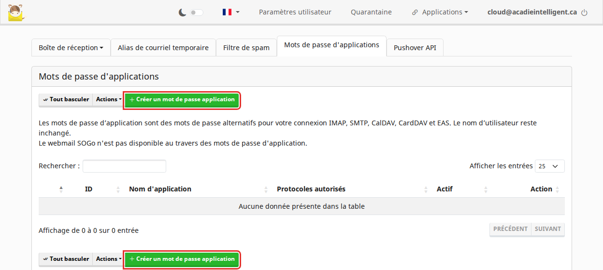
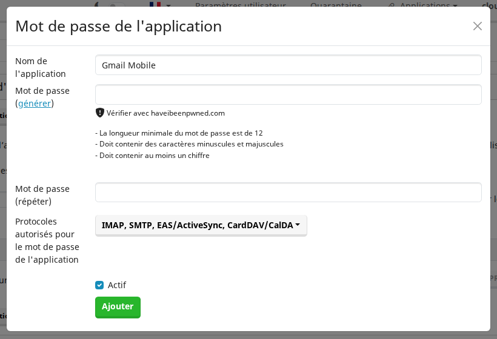
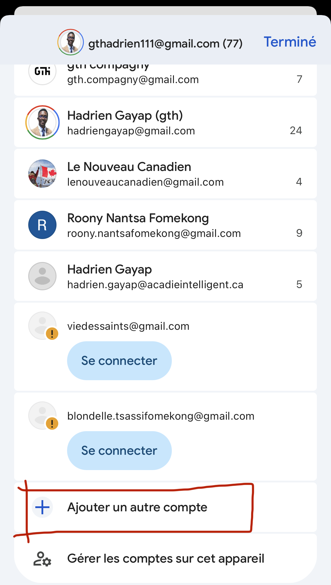
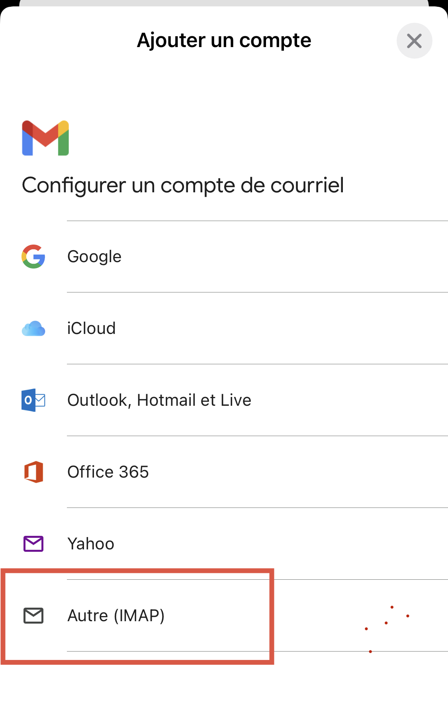
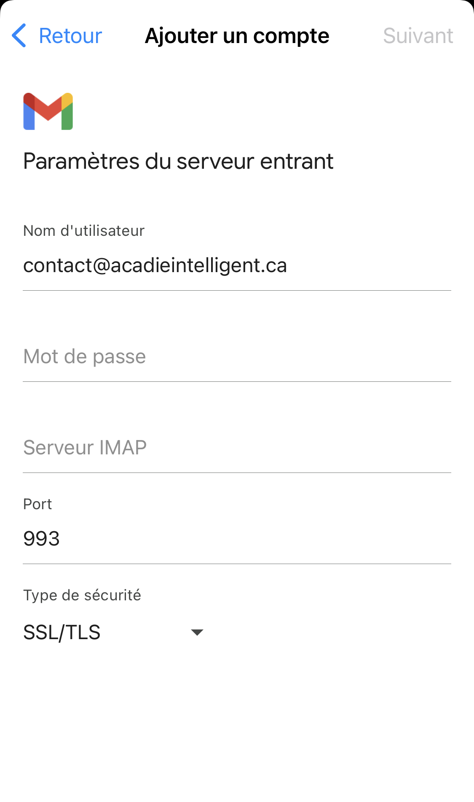
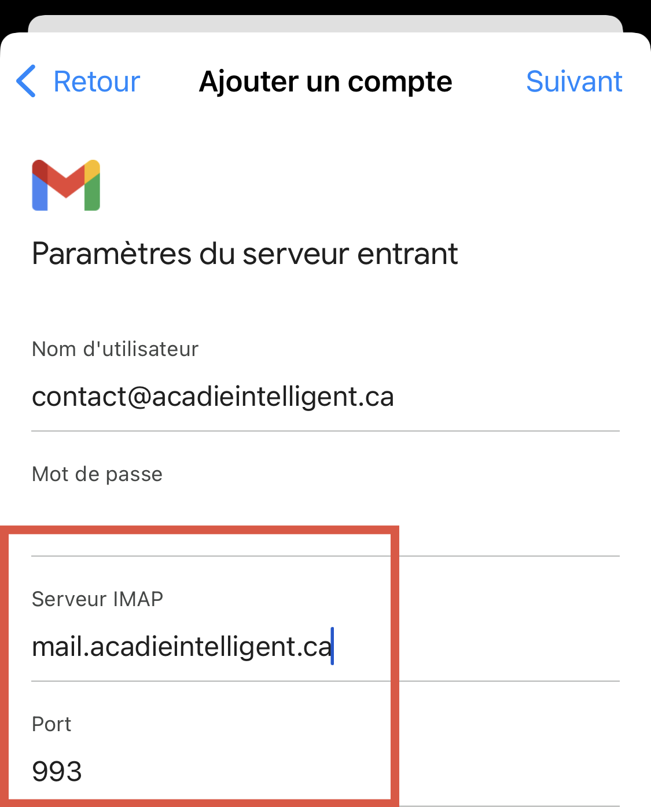
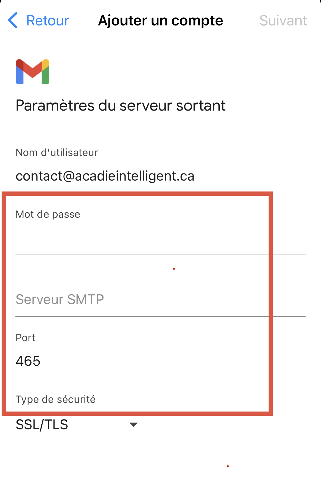

# Guides : courriel @acadieintelligent.ca et Nextcloud

| Guide | Pour |
|---|---|
| **[Nextcloud](nextcloud.md)** (nouveau) | L'espace commun de l'équipe sur https://cloud.acadieintelligent.ca : documents, dossiers par projet, Word et Excel à plusieurs, courriel, agenda et contacts. Connexion avec votre courriel. |
| **Courriel dans Gmail** (ci-dessous) | Votre adresse `@acadieintelligent.ca` dans Gmail, Apple Mail, Outlook ou Thunderbird. |

Le webmail SOGo (`https://mail.acadieintelligent.ca/SOGo`) est remplacé peu à peu par l'application **Mail** de
Nextcloud ([section 4 du guide Nextcloud](nextcloud.md#4-le-courriel-dans-nextcloud-application-mail)).

---

# Ajouter votre courriel @acadieintelligent.ca à Gmail

Ce guide vous accompagne étape par étape pour connecter votre adresse courriel Acadie Intelligent à l'application Gmail sur votre téléphone, tablette ou ordinateur.

---

## Étape 1 — Générer un mot de passe d'application dans Mailcow

Votre compte courriel utilise l'authentification à deux facteurs (2FA), ce qui signifie que votre mot de passe habituel ne fonctionnera pas dans Gmail. Vous devez générer un **mot de passe d'application** spécial.

### 1.1 Se connecter au panneau mail

1. Ouvrez votre navigateur et allez à : **https://mail.acadieintelligent.ca**
2. L'encadré doit indiquer **Connexion Utilisateur** en haut (pas Administrateur)
3. Entrez votre adresse courriel complète (ex : `votrenom@acadieintelligent.ca`) et votre mot de passe habituel
4. Complétez la vérification 2FA si demandée



### 1.2 Générer le mot de passe d'application

1. Une fois connecté, ouvrez **https://mail.acadieintelligent.ca/user** (lien **Paramètres utilisateur** en haut).
   Si le webmail s'ouvre à la place, allez simplement à cette adresse.
2. Cliquez sur l'onglet **Mots de passe d'applications**



3. Cliquez sur **Créer un mot de passe application**



4. **Nom de l'application** : `Gmail Mobile` (c'est juste une étiquette pour vous y retrouver)
5. Cliquez sur le lien **générer**, à côté de « Mot de passe » : un mot de passe solide remplit les deux champs
6. **Copiez ce mot de passe immédiatement** : vous ne pourrez plus le voir après
7. Laissez les protocoles cochés (au minimum **IMAP** et **SMTP**), puis cliquez sur **Ajouter**
8. Gardez cette page ouverte ou collez le mot de passe en lieu sûr temporairement



---

## Étape 2 — Ajouter le compte dans Gmail

### Sur Android

1. Ouvrez l'application **Gmail**
2. Appuyez sur votre **photo de profil** (en haut à droite) → **Ajouter un autre compte**



3. Sélectionnez **Autre (IMAP)**



4. Entrez votre adresse complète : `contact@acadieintelligent.ca`
5. Appuyez sur **Suivant**
6. Sélectionnez **Personnel (IMAP)**
7. Entrez votre **mot de passe d'application** (celui généré à l'étape 1, PAS votre mot de passe habituel)
8. Appuyez sur **Suivant**

### Sur iPhone / iPad

1. Ouvrez l'application **Gmail**
2. Appuyez sur votre **photo de profil** (en haut à droite) → **Ajouter un autre compte**
3. Sélectionnez **Autre (IMAP)**
4. Entrez votre adresse complète : `contact@acadieintelligent.ca`
5. Appuyez sur **Suivant**
6. Entrez votre **mot de passe d'application**
7. Appuyez sur **Suivant**

---

## Étape 3 — Paramètres du serveur entrant (IMAP)

Si Gmail demande une configuration manuelle, entrez :

| Champ | Valeur |
|-------|--------|
| **Nom d'utilisateur** | `contact@acadieintelligent.ca` (adresse complète) |
| **Mot de passe** | Votre mot de passe d'application de l'étape 1 |
| **Serveur IMAP** | `mail.acadieintelligent.ca` |
| **Port** | `993` |
| **Type de sécurité** | `SSL/TLS` |

Appuyez sur **Suivant** une fois terminé.

<table><tr>
<td></td>
<td></td>
</tr></table>

---

## Étape 4 — Paramètres du serveur sortant (SMTP)

| Champ | Valeur |
|-------|--------|
| **Serveur SMTP** | `mail.acadieintelligent.ca` |
| **Port** | `587` |
| **Type de sécurité** | `STARTTLS` |
| **Authentification requise** | Oui |
| **Nom d'utilisateur** | `contact@acadieintelligent.ca` (adresse complète) |
| **Mot de passe** | Même mot de passe d'application de l'étape 1 |

Appuyez sur **Suivant** une fois terminé.



---

## Étape 5 — Paramètres finaux

Gmail peut vous demander de configurer :

- **Fréquence de synchronisation** : Choisissez à quelle fréquence Gmail vérifie les nouveaux courriels (15 minutes recommandé)
- **Notifications** : Activez si vous voulez être notifié des nouveaux courriels
- **Nom du compte** : `Acadie Intelligent` (apparaît dans votre liste de comptes)
- **Votre nom** : Votre nom complet (apparaît comme expéditeur lorsque vous envoyez un courriel)

Appuyez sur **Terminé**.

---

## Vérification

Une fois le compte ajouté :

1. Ouvrez Gmail et basculez vers votre compte `@acadieintelligent.ca`
2. **Envoyez un courriel de test** à votre Gmail personnel pour vérifier l'envoi
3. **Répondez depuis votre Gmail personnel** pour vérifier la réception
4. Vérifiez que les courriels envoyés affichent votre nom et l'adresse `@acadieintelligent.ca`

---

## Ajouter à d'autres applications de messagerie

Les mêmes paramètres serveur fonctionnent pour toute application de messagerie.

### Apple Mail (macOS / iOS)

1. **Réglages → Mail → Comptes → Ajouter un compte → Autre**
2. Entrez votre adresse courriel et le mot de passe d'application
3. Apple Mail détecte habituellement les paramètres automatiquement

### Outlook (ordinateur ou mobile)

1. **Fichier → Ajouter un compte** (ordinateur) ou **Paramètres → Ajouter un compte** (mobile)
2. Entrez votre adresse courriel
3. Sélectionnez **IMAP** si le type de compte est demandé
4. Entrez les paramètres serveur des étapes 3 et 4

### Thunderbird

1. **Paramètres des comptes → Actions → Ajouter un compte de messagerie**
2. Entrez votre nom, adresse courriel et mot de passe d'application
3. Thunderbird détecte automatiquement les paramètres grâce à l'enregistrement DNS `autoconfig`

---

## Dépannage

### « Nom d'utilisateur ou mot de passe incorrect »

- Assurez-vous d'utiliser le **mot de passe d'application**, pas votre mot de passe habituel
- Le nom d'utilisateur doit être l'**adresse courriel complète** (ex : `contact@acadieintelligent.ca`), pas seulement `contact`
- Si le mot de passe d'application ne fonctionne pas, générez-en un nouveau sur https://mail.acadieintelligent.ca

### « Impossible de se connecter au serveur »

- Vérifiez que le serveur est `mail.acadieintelligent.ca` (pas `acadieintelligent.ca`)
- Le port IMAP doit être `993` avec `SSL/TLS`
- Le port SMTP doit être `587` avec `STARTTLS`
- Vérifiez que vous avez une connexion internet

### « Échec d'authentification » après un changement de mot de passe

Si vous changez votre mot de passe Mailcow, tous les mots de passe d'application existants sont révoqués. Vous devez :

1. Générer un nouveau mot de passe d'application sur https://mail.acadieintelligent.ca
2. Mettre à jour le mot de passe dans Gmail : **Paramètres → votre compte → Paramètres du compte → Modifier**

### Les courriels ne se synchronisent pas

- Vérifiez la fréquence de synchronisation dans les paramètres Gmail (15 minutes ou moins)
- Essayez de rafraîchir manuellement en tirant vers le bas sur la boîte de réception
- Vérifiez que le compte est configuré pour se synchroniser dans les paramètres du compte Gmail

---

## Aide-mémoire

```
Adresse courriel :          votrenom@acadieintelligent.ca
Serveur IMAP :              mail.acadieintelligent.ca
Port IMAP :                 993 (SSL/TLS)
Serveur SMTP :              mail.acadieintelligent.ca
Port SMTP :                 587 (STARTTLS)
Webmail :                   https://cloud.acadieintelligent.ca/apps/mail (Nextcloud Mail)
                            (ancien : https://mail.acadieintelligent.ca/SOGo, retiré peu à peu)
Mots de passe d'application : https://mail.acadieintelligent.ca (connexion utilisateur → paramètres)
Nextcloud :                 https://cloud.acadieintelligent.ca (bouton « Courriel Acadie Intelligent »)
```

---

*Acadie Intelligent Inc. — Documentation interne*