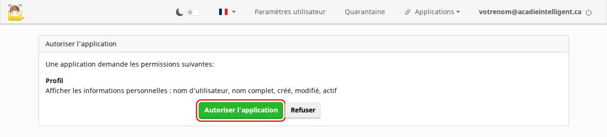
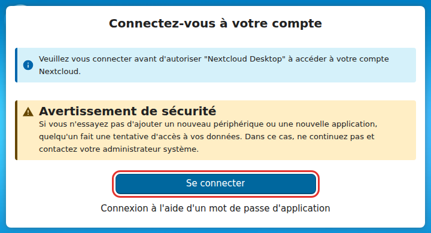
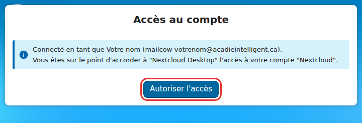
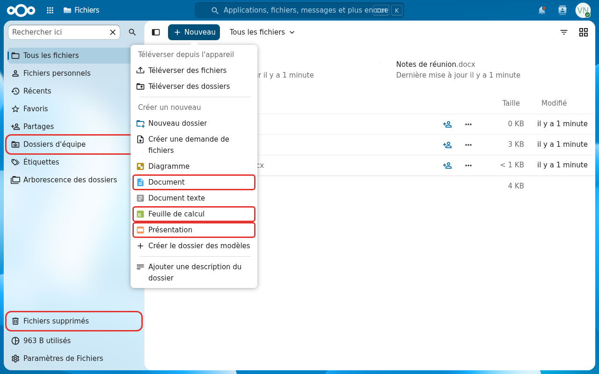
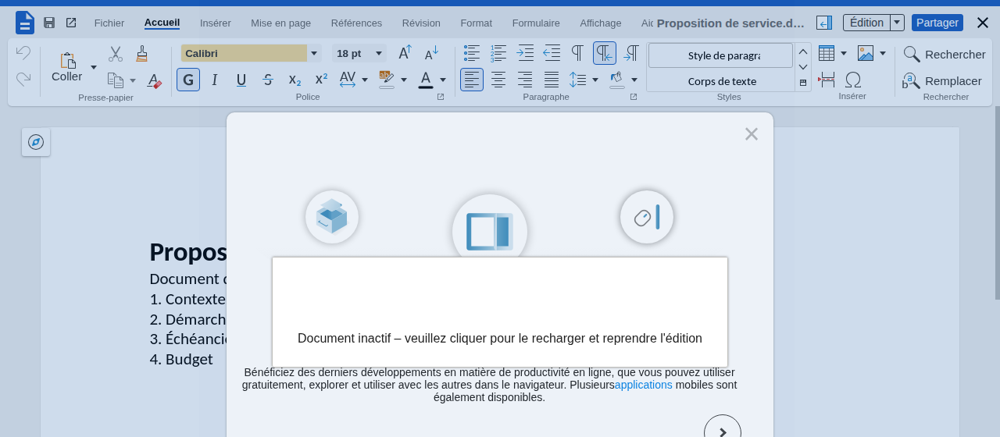
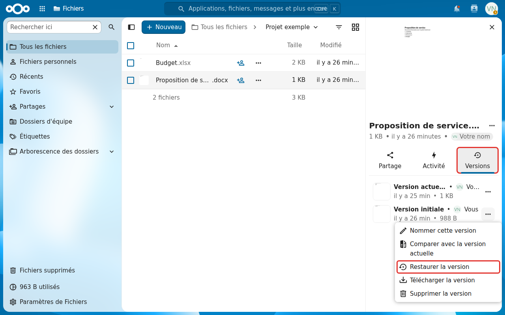
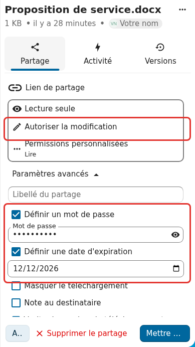
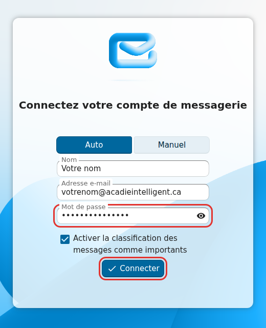
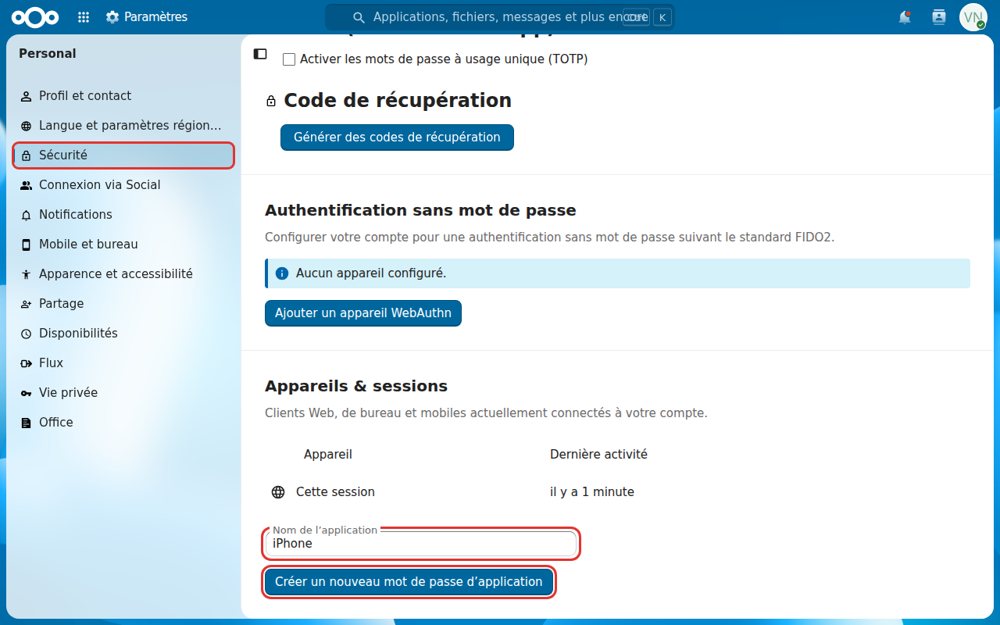
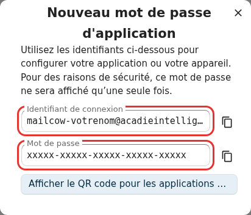

# Nextcloud d'Acadie Intelligent : https://cloud.acadieintelligent.ca

Nextcloud est l'espace commun de l'équipe : vos documents, les dossiers partagés par projet, l'édition à plusieurs
des fichiers Word et Excel dans le navigateur, et aussi votre courriel, votre agenda et vos contacts.

Vous n'avez **pas de mot de passe Nextcloud** : vous entrez avec votre courriel `@acadieintelligent.ca`.

---

## 1. Se connecter dans le navigateur

1. Allez à **https://cloud.acadieintelligent.ca**
2. Cliquez sur le bouton **Courriel Acadie Intelligent**, sous le formulaire. Le formulaire « Nom d'utilisateur ou
   adresse e-mail » au-dessus n'est pas pour vous.

3. Vous arrivez sur la page de connexion du courriel (`mail.acadieintelligent.ca`). Entrez votre **adresse complète**
   et votre **mot de passe de courriel habituel** (pas un mot de passe d'application), puis la vérification en deux
   étapes si elle vous est demandée.

4. La première fois, cliquez sur **Autoriser l'application** (*Authorize application* si la page est en anglais).

5. Vous revenez dans Nextcloud, connecté.

---

## 2. Installer les applications

Les applications ouvrent la même page de connexion que ci-dessus, avec deux écrans de plus : **Se connecter** au
début, **Autoriser l'accès** à la fin.

<table><tr>
<td></td>
<td></td>
</tr></table>

### Ordinateur (Windows, macOS, Linux) : synchronisation des fichiers

1. Téléchargez **Nextcloud Desktop** : https://nextcloud.com/install/
2. Adresse du serveur : `https://cloud.acadieintelligent.ca`
3. Le navigateur s'ouvre : **Se connecter**, **Courriel Acadie Intelligent**, connexion (comme à la section 1), puis
   **Autoriser l'accès**.
4. Choisissez le dossier de votre ordinateur à synchroniser. Avec les **fichiers virtuels**, les fichiers ne sont
   téléchargés qu'à l'ouverture : utile pour les gros dossiers (maquettes, vidéos).

### Téléphone et tablette (iPhone, iPad, Android)

1. Installez l'application **Nextcloud** (App Store ou Google Play).
2. Adresse du serveur : `cloud.acadieintelligent.ca`
3. Touchez **Se connecter**, puis **Courriel Acadie Intelligent**, connectez-vous, touchez **Autoriser
   l'application** (la première fois), puis **Autoriser l'accès**.

---

## 3. Travailler sur les documents

- **Nouveau document** : bouton **+ Nouveau**, puis **Document**, **Feuille de calcul** ou **Présentation**
  (« Document texte » crée une simple note, pas un fichier Word).
- **Dossiers d'équipe** (menu de gauche) : les dossiers partagés par projet, créés par l'administrateur avec les droits
  de chacun (lecture ou modification).
- **Fichiers supprimés** (en bas à gauche) : la corbeille, gardée **au moins 30 jours**.

- Les documents s'ouvrent dans le navigateur (**Nextcloud Office**), avec les menus habituels d'un traitement de
  texte ; plusieurs personnes peuvent écrire en même temps. Les fichiers Word (`.docx`), Excel (`.xlsx`) et PowerPoint
  (`.pptx`) existants s'ouvrent de la même façon, d'un clic. L'enregistrement est automatique ; la croix en haut à
  droite referme le document.

- **Historique** : ouvrez le panneau de détails du fichier (par exemple avec l'icône de partage de sa ligne), onglet
  **Versions**, puis le menu **…** d'une version et **Restaurer la version**.

### Partager avec une personne de l'extérieur

1. Cliquez sur l'icône de partage du fichier ou du dossier : le panneau s'ouvre sur l'onglet **Partage**.
2. Sous **Partages externes**, sur la ligne **Créer un lien de partage public**, cliquez sur **+**. Une date
   d'expiration est proposée (30 jours) : **Créer un partage**.
3. Menu **…** du lien, puis **Personnaliser le lien** :
   - **Lecture seule** ou **Autoriser la modification** ;
   - **Définir un mot de passe** : Nextcloud en propose un (l'œil l'affiche), ou tapez le vôtre ;
   - **Définir une date d'expiration** ;
   - puis **Mettre à jour le partage**.
4. Envoyez le lien, et le mot de passe par un autre moyen (texto, appel).

---

## 4. Le courriel dans Nextcloud (application Mail)

La première fois, Mail vous demande le mot de passe de votre boîte : Nextcloud ne le connaît pas, puisque vous vous
êtes connecté par la page du courriel. C'est une seule fois, il est ensuite gardé chiffré.

1. Créez un **mot de passe d'application** nommé `Nextcloud` sur https://mail.acadieintelligent.ca (voir l'étape 1 du
   [guide Gmail](README.md#étape-1--générer-un-mot-de-passe-dapplication-dans-mailcow)), avec IMAP et SMTP.
2. Ouvrez **Mail** dans Nextcloud, laissez le mode **Auto**, vérifiez votre nom et votre adresse.
3. **Effacez** le champ du mot de passe (le navigateur le remplit parfois tout seul avec un autre mot de passe), collez
   le mot de passe d'application, puis **Connecter**.

Vos courriels restent sur le serveur de courriel : Gmail, Apple Mail ou Outlook continuent de fonctionner à côté.

---

## 5. Agenda et contacts sur le téléphone ou l'ordinateur

Les applications Agenda et Contacts de Nextcloud se synchronisent avec le téléphone (CalDAV et CardDAV).

1. Dans Nextcloud : votre photo (en haut à droite), **Paramètres**, puis **Sécurité** dans le menu de gauche. Tout en
   bas, section **Appareils & sessions** : **Nom de l'application** (`iPhone`, par exemple), puis **Créer un nouveau
   mot de passe d'application**.

   Nextcloud affiche un **Identifiant de connexion** (de la forme `mailcow-votrenom@acadieintelligent.ca`) et un
   **Mot de passe** : utilisez exactement ces deux-là. Le mot de passe n'est affiché **qu'une fois** : gardez la
   fenêtre ouverte jusqu'à la fin.

2. **iPhone / iPad** : Réglages, Calendrier (sous **Apps** sur les versions récentes), Comptes, Ajouter un compte,
   Autre, **Compte CalDAV** ; puis la même chose dans Contacts avec **Compte CardDAV**. Serveur :
   `cloud.acadieintelligent.ca` ; nom d'utilisateur : l'identifiant de connexion de l'étape 1 ; mot de passe : celui de
   l'étape 1.
3. **Android** : application **DAVx⁵**, « Connexion avec une URL et un nom d'utilisateur », URL
   `https://cloud.acadieintelligent.ca/remote.php/dav`, avec l'identifiant de connexion et le mot de passe de l'étape 1.
4. **macOS** : Réglages Système, Comptes Internet, Ajouter un compte, Autre, CalDAV puis CardDAV, mêmes informations.

---

## Dépannage

### « La connexion a échoué » sur la page du courriel

- Vérifiez l'**adresse** : sur téléphone, la correction automatique change parfois `acadieintelligent` en un mot voisin.
- Utilisez votre **mot de passe de courriel habituel**, pas un mot de passe d'application.
- Après plusieurs échecs, les connexions sont **bloquées pour un moment** : attendez, ou écrivez à l'administrateur.

### Nextcloud redemande un mot de passe en boucle (« Authentification requise »)

Votre compte doit être dispensé de cette confirmation : écrivez à l'administrateur.

### « Erreur d'authentification IMAP » dans Mail

Le mot de passe saisi n'est pas le bon : effacez le champ, collez votre mot de passe d'application (section 4), puis
**Connecter**.

### Je n'ai pas de compte

Les comptes sont créés par l'administrateur : demandez-lui le vôtre.

---

*Acadie Intelligent Inc. — Documentation interne*
