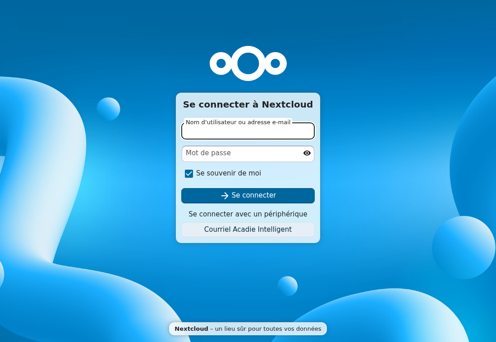

# Nextcloud d'Acadie Intelligent : https://cloud.acadieintelligent.ca

Nextcloud est l'espace commun de l'équipe : vos documents, les dossiers partagés par projet, l'édition à plusieurs
des fichiers Word et Excel dans le navigateur, et aussi votre courriel, votre agenda et vos contacts.

Vous n'avez **pas de mot de passe Nextcloud** : vous entrez avec votre courriel `@acadieintelligent.ca`.

---

## 1. Se connecter dans le navigateur

1. Allez à **https://cloud.acadieintelligent.ca**
2. Cliquez sur le bouton **Courriel Acadie Intelligent**, sous le formulaire. Le formulaire « Nom d'utilisateur ou
   adresse e-mail » au-dessus n'est pas pour vous.

3. Vous arrivez sur la page de connexion du courriel (`mail.acadieintelligent.ca`). Entrez votre **adresse complète**
   et votre **mot de passe de courriel habituel** (pas un mot de passe d'application), puis la vérification en deux
   étapes si elle vous est demandée.
4. La première fois, cliquez sur **Authorize application**.
5. Vous revenez dans Nextcloud, connecté.

---

## 2. Installer les applications

Les applications ouvrent la même page de connexion que ci-dessus.

### Ordinateur (Windows, macOS, Linux) : synchronisation des fichiers

1. Téléchargez **Nextcloud Desktop** : https://nextcloud.com/install/
2. Adresse du serveur : `https://cloud.acadieintelligent.ca`
3. Le navigateur s'ouvre : **Courriel Acadie Intelligent**, connexion, puis **Autoriser l'accès**.
4. Choisissez le dossier de votre ordinateur à synchroniser. Avec les **fichiers virtuels**, les fichiers ne sont
   téléchargés qu'à l'ouverture : utile pour les gros dossiers (maquettes, vidéos).

### Téléphone et tablette (iPhone, iPad, Android)

1. Installez l'application **Nextcloud** (App Store ou Google Play).
2. Adresse du serveur : `cloud.acadieintelligent.ca`
3. Touchez **Courriel Acadie Intelligent**, connectez-vous, touchez **Authorize application**, puis **Autoriser
   l'accès**.

---

## 3. Travailler sur les documents

- **Nouveau document** : bouton **+ Nouveau**, puis Document, Feuille de calcul ou Présentation. Ils s'ouvrent dans le
  navigateur (Nextcloud Office) ; plusieurs personnes peuvent écrire en même temps.
- Les fichiers Word (`.docx`), Excel (`.xlsx`) et PowerPoint (`.pptx`) existants s'ouvrent de la même façon, d'un clic.
- **Dossiers d'équipe** (menu de gauche) : les dossiers partagés par projet, créés par l'administrateur avec les droits
  de chacun (lecture ou modification).
- **Historique** : dans le panneau de détails d'un fichier, onglet **Versions**, pour revenir à une version précédente.
- **Fichiers supprimés** (en bas à gauche) : la corbeille, gardée **au moins 30 jours**.

### Partager avec une personne de l'extérieur

1. Icône de partage du fichier ou du dossier, puis **Créer un lien public**.
2. Dans les réglages du lien : **mot de passe** et **date d'expiration** (proposée à 30 jours), et le droit de
   modifier ou non.
3. Envoyez le lien, et le mot de passe par un autre moyen (texto, appel).

---

## 4. Le courriel dans Nextcloud (application Mail)

La première fois, Mail vous demande le mot de passe de votre boîte : Nextcloud ne le connaît pas, puisque vous vous
êtes connecté par la page du courriel. C'est une seule fois, il est ensuite gardé chiffré.

1. Créez un **mot de passe d'application** nommé `Nextcloud` sur https://mail.acadieintelligent.ca (voir l'étape 1 du
   [guide Gmail](README.md#étape-1--générer-un-mot-de-passe-dapplication-dans-mailcow)), avec IMAP et SMTP.
2. Ouvrez **Mail** dans Nextcloud, laissez le mode **Auto**, vérifiez votre nom et votre adresse.
3. **Effacez** le champ du mot de passe (le navigateur le remplit parfois tout seul avec un autre mot de passe), collez
   le mot de passe d'application, puis **Connecter**.

Vos courriels restent sur le serveur de courriel : Gmail, Apple Mail ou Outlook continuent de fonctionner à côté.

---

## 5. Agenda et contacts sur le téléphone ou l'ordinateur

Les applications Agenda et Contacts de Nextcloud se synchronisent avec le téléphone (CalDAV et CardDAV).

1. Dans Nextcloud : votre photo, **Paramètres personnels**, **Sécurité**, **Créer un nouveau mot de passe
   d'application** (nom : `iPhone`, par exemple). Nextcloud affiche un **nom d'utilisateur** et un **mot de passe** :
   utilisez exactement ces deux-là.
2. **iPhone / iPad** : Réglages, Calendrier (sous **Apps** sur les versions récentes), Comptes, Ajouter un compte,
   Autre, **Compte CalDAV** ; puis la même chose dans Contacts avec **Compte CardDAV**. Serveur : `cloud.acadieintelligent.ca`, avec le nom d'utilisateur et le mot de passe de
   l'étape 1.
3. **Android** : application **DAVx⁵**, « Connexion avec une URL et un nom d'utilisateur », URL
   `https://cloud.acadieintelligent.ca/remote.php/dav`, avec le nom d'utilisateur et le mot de passe de l'étape 1.
4. **macOS** : Réglages Système, Comptes Internet, Ajouter un compte, Autre, CalDAV puis CardDAV, mêmes informations.

---

## Dépannage

### « La connexion a échoué » sur la page du courriel

- Vérifiez l'**adresse** : sur téléphone, la correction automatique change parfois `acadieintelligent` en un mot voisin.
- Utilisez votre **mot de passe de courriel habituel**, pas un mot de passe d'application.
- Après plusieurs échecs, les connexions sont **bloquées pour un moment** : attendez, ou écrivez à l'administrateur.

### Nextcloud redemande un mot de passe en boucle (« Authentification requise »)

Votre compte doit être dispensé de cette confirmation : écrivez à l'administrateur.

### « Erreur d'authentification IMAP » dans Mail

Le mot de passe saisi n'est pas le bon : effacez le champ, collez votre mot de passe d'application (section 4), puis
**Connecter**.

### Je n'ai pas de compte

Les comptes sont créés par l'administrateur : demandez-lui le vôtre.

---

*Acadie Intelligent Inc. — Documentation interne*
